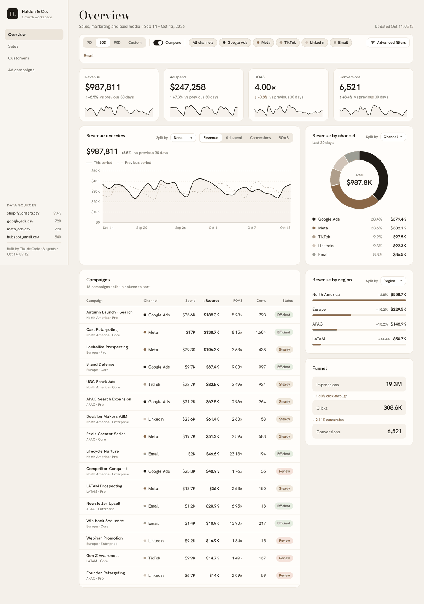
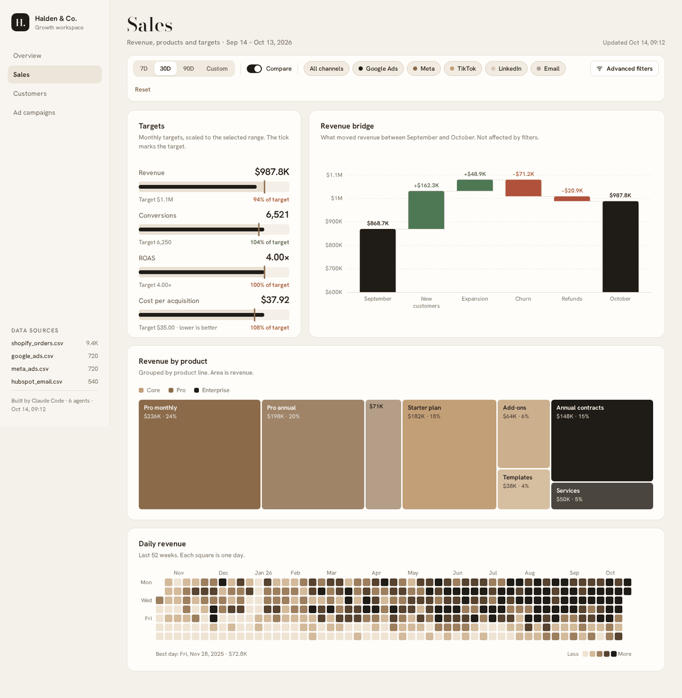
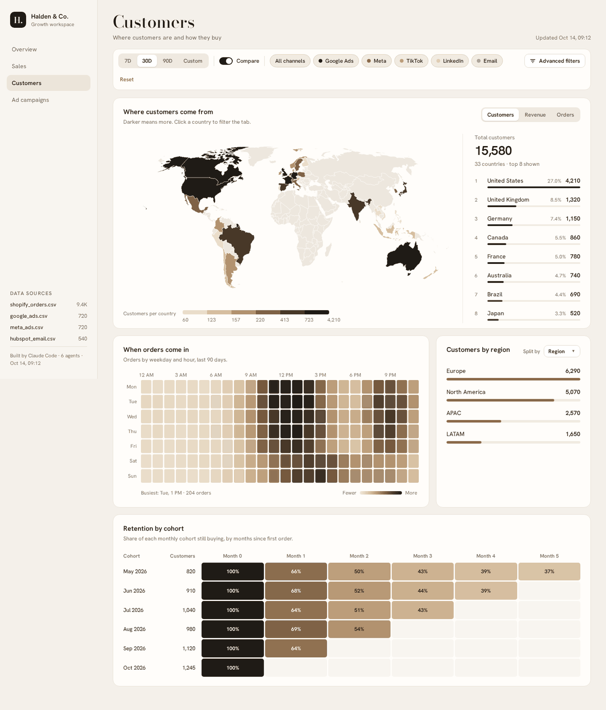
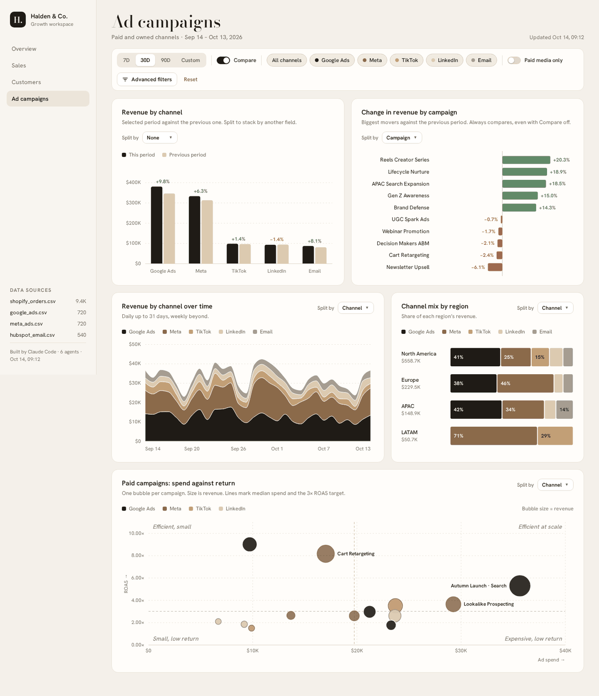

# Wizard Data Analyst

Un plugin pentru [Claude Code](https://claude.com/claude-code) care transformă datele firmei tale într-un **dashboard interactiv**, cu grafice, filtre și concluzii, într-un singur fișier HTML.

Îi dai un folder cu ce ai: exporturi din Stripe sau Shopify, rapoarte din Google Ads și Meta, Excel-uri de la contabilitate, facturi PDF, tichete de suport. Claude citește tot, curăță datele, caută ce s-a schimbat și de ce, apoi îți construiește un raport pe care îl deschizi cu dublu-click și îl poți trimite oricui.



## Ce face, pe scurt

- **Citește aproape orice:** CSV, Excel (.xlsx), JSON, PDF (de ex. facturi), Word (.docx), emailuri (.eml), notițe (.md).
- **Curăță datele ca un analist:** aceeași țară scrisă în zece feluri, sume cu `1.234,56` sau `1,234.56`, date în formate amestecate, mai multe monede, rânduri duplicate.
- **Caută povestea din date:** ce a crescut, ce pierde bani, unde sunt clienții, când pleacă, ce campanii merită oprite. Fiecare concluzie vine cu cifre.
- **Construiește un dashboard** cu 3–5 taburi și până la 16 tipuri de grafice: linii, bare, donut, funnel, scatter, waterfall, heatmap, cohorte, treemap, calendar, hartă a lumii, tabele sortabile.
- **Îl testează singur** într-un browser invizibil înainte să ți-l dea: dă click pe fiecare tab și verifică să nu fie niciun grafic gol sau vreo eroare.

## Instalare

În Claude Code, o singură dată:

```
/plugin marketplace add silviu-life/wizard-data-analyst
/plugin install wizard-data-analyst@wizard-data-analyst
```

Apoi scrie:

```
/wizard-data-install
```

Îți explică pe înțelesul oricui, cu metafore, ce programe îi trebuie (Node.js, Playwright, Python) și de ce. Te întreabă înainte de fiecare instalare și la final face un raport de probă, ca să vezi că totul merge. Dacă le ai deja, trece repede mai departe.

Actualizare: `/plugin marketplace update wizard-data-analyst`.

## Folosire

Deschide Claude Code în folderul în care vrei să lucrezi și scrie:

```
/wizard-data-dashboard date/
```

`date/` e folderul cu fișierele tale. Claude te întreabă cât de detaliată să fie analiza:

| Nivel | Cine lucrează | Când îl alegi |
|---|---|---|
| **Rapidă** | Claude, singur | Puține fișiere, o primă privire, câteva minute |
| **Standard** (recomandat) | Claude face planul, apoi 2–4 asistenți lucrează în paralel, fiecare pe o parte din date | Majoritatea cazurilor |
| **Aprofundată** | Un workflow cu mai mulți agenți: un planificator, câte un agent pe fiecare zonă (vânzări, marketing, suport, finanțe), un verificator care recalculează fiecare cifră și un asamblor | Multe fișiere, date murdare, o analiză pe care o prezinți mai departe |

Poți spune nivelul direct și sari peste întrebare:

```
/wizard-data-dashboard rapidă date/
/wizard-data-dashboard aprofundată exporturi/2026/
```

La final primești calea către raport și 3–5 concluzii scrise simplu. De exemplu: „Campania Meta Advantage+ a adus clienți la $3.360 bucata, de 5 ori peste media firmei.”

## Ce primești

Fiecare analiză are folderul ei, așa că nu se suprascrie nimic:

```
analize/<firma>-<subiect>-<data>/
  dashboard.html     raportul: se deschide cu dublu-click, se trimite pe email
  dashboard.json     toate datele și setările raportului
  datasets/*.json    fiecare set de date curățat, separat
  plan.md            planul analizei: ce surse, ce grafice, ce ipoteze
  scripts/           programele de curățare, ca analiza să poată fi refăcută pe date noi
  screenshots/       câte o poză pe tab, din testul final
```

## Cum arată raportul

Imaginile de mai jos sunt făcute cu datele de exemplu incluse în plugin, ale firmei inventate „Halden & Co.”. Pe datele tale, textele raportului apar în română.

**Vânzări**: cât din țintă s-a atins, ce a mișcat venitul de la o lună la alta (clienți noi, extinderi, abandon, rambursări), venitul pe produse și fiecare zi a anului.



**Clienți**: harta lumii, ora la care vin comenzile și cât de mulți clienți rămân de la o lună la alta (cohorte).



**Campanii**: venitul pe canale față de perioada anterioară, campaniile care au crescut sau au scăzut cel mai mult, mixul pe regiuni și harta cheltuială–randament, unde se văd campaniile eficiente și cele scumpe.



Ce poți face în raport:
- alegi perioada (7, 30, 90 de zile sau personalizat) și compari cu perioada anterioară;
- filtrezi pe canal, regiune, produs sau ce are sens pentru datele tale, iar toate graficele se schimbă odată;
- împarți un grafic după o dimensiune („Split by”), dai click pe o țară sau pe o bară ca să filtrezi tot tabul, sortezi orice tabel.

Raportul are nevoie de internet când îl deschizi, pentru grafice și harta lumii.

## Date demo pentru curs: Lumora Software

Ca să încerci pluginul fără date reale, ai la dispoziție datele unei firme inventate: **Lumora Software**, o firmă SaaS cu clienți în 48 de țări. Sunt ~1.800 de fișiere pe 33 de luni:

- plăți Stripe, cu formatul schimbat la jumătatea perioadei;
- 900 de facturi PDF;
- CRM-ul cu 91.000 de contacte;
- Google Ads, Meta și LinkedIn;
- Google Analytics;
- tichete de suport și sondaje NPS în 6 limbi;
- contabilitate, bugete;
- rapoarte pentru board, emailuri și notițe de ședință.

Datele sunt murdare intenționat, exact ca la o firmă reală.

Datele se generează pe calculatorul tău, în aproximativ 30 de secunde. În folderul în care vrei să lucrezi, rulează:

```
curl -O https://raw.githubusercontent.com/silviu-life/wizard-data-analyst/main/demo/genereaza_date_demo.py
pip install numpy openpyxl reportlab python-docx
python3 genereaza_date_demo.py
```

Pe Windows, folosește `py` în loc de `python3`. Dacă nu vrei să scrii comenzile, cere-i lui Claude Code: „descarcă și rulează generatorul de date demo din wizard-data-analyst”.

Apare un folder `date/` (~1.800 de fișiere, ~70 MB). Apoi rulează:

```
/wizard-data-dashboard standard date/
```

În datele demo sunt ascunse câteva povești, de exemplu o scumpire care a dublat rata de abandon sau o pană a aplicației care se vede în cinci surse diferite. Lista e în [`demo/ce_e_ascuns_in_date.md`](demo/ce_e_ascuns_in_date.md). Citește-o după ce rulezi analiza, ca să vezi cât a găsit Claude.

## Bine de știut

- **Datele tale rămân în folderul tău.** Fișierele originale nu sunt modificate: curățarea se face pe copii. Ca orice lucru făcut cu Claude Code, conținutul pe care îl citește Claude ajunge la modelul Claude ca să poată fi analizat. Pentru date foarte sensibile, anonimizează-le întâi: nume, emailuri, CNP-uri.
- **Cifrele sunt verificate, dar nu sunt infailibile.** La nivelul Aprofundată, un agent separat recalculează fiecare concluzie din datele brute și le respinge pe cele pe care nu le poate reproduce. Pentru decizii importante, verifică cifrele-cheie și tu.
- **Durata și consumul cresc cu nivelul.** Rapidă: câteva minute. Aprofundată pe sute de fișiere: zeci de minute și mult mai multe tokenuri.
- **Nu există buton de export în PDF.** Raportul se printează din browser (Ctrl+P → Salvează ca PDF).

## Dezvoltare

Codul e în `plugins/wizard-data-analyst/skills/`:

- `wizard-data-dashboard/`:
  - `SKILL.md`: fluxul și nivelurile;
  - `template/`: renderer-ul HTML, schema și validatorul (nu se editează);
  - `scripts/`: `profile.js`, `assemble.js`, `build.js`, `check.js`;
  - `workflows/deep-analysis.js`: workflow-ul pentru nivelul Aprofundată.
- `wizard-data-install/SKILL.md`: instalarea ghidată.

Test local: `claude --plugin-dir plugins/wizard-data-analyst`. După orice schimbare, crește `version` în `plugins/wizard-data-analyst/.claude-plugin/plugin.json`, altfel cursanții nu primesc actualizarea.

Verificare rapidă: construiește exemplul și testează-l în browser (cere Node.js și Playwright):

```
D=plugins/wizard-data-analyst/skills/wizard-data-dashboard
node $D/scripts/build.js $D/examples/dashboard.example.json out/test.html
node $D/scripts/check.js out/test.html out/shots
```
